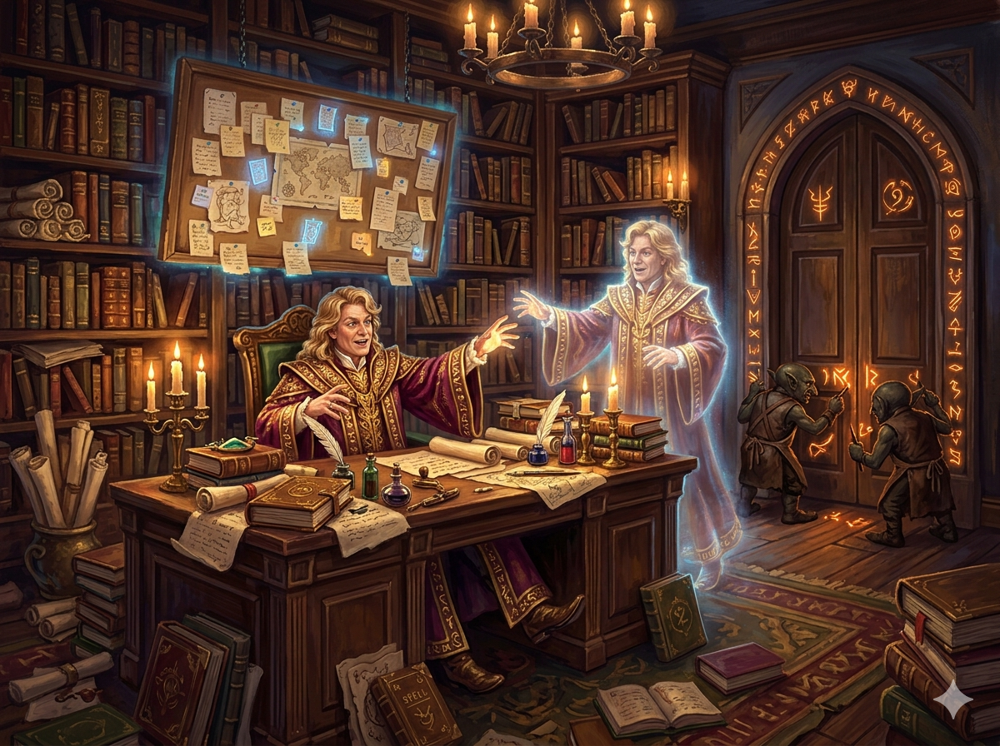

I was introduced to the world of Harry Potter twenty-five years ago, and the world of
Claude Code three months ago. This weekend I found myself thinking about everything they
have in common. What follows is what came out as a result -- coauthored by me and my dear
friend Gilderoy Lockhart.

## The Forgetful Wizard

At the center of this story is Gilderoy Lockhart: Defense Against the Dark Arts professor,
Order of Merlin Third Class, and the dashing **model** at the center of this office (and
of Claude Code).

He is powerful. Broad knowledge. Capable of casting remarkable spells. The catch: due to
a backfired charm, he has no short-term memory. Whenever a task at hand finishes, Lockhart
will forget everything that happened and need to start fresh.

He is also, famously, prone to confabulation. Not out of malice — he simply cannot
distinguish between knowing something and believing he knows it. The spell fires either way.

Only having permanence about the world immediately before him would normally be a curse.
But Lockhart works around this with the aid of a desk, many parchments, and the ability to
read very, very quickly.

## The Desk Full of Parchments

Lockhart's desk is the heart of every session. Everything on it is in active use. He must
personally read and synthesize every parchment before casting his spells; **attention is
the bottleneck for his power**.

If you want to work with him effectively, everything he needs must be on the desk before he
starts. Don't assume he remembers last time. He doesn't. But within a session, given what's
on the desk, he can do extraordinary work.

Here is the inexplicable thing: the desk cannot be enlarged. Not by Undetectable Extension
Charms. Not by anything. The wizarding world has no explanation for this -- it simply is.

This is the **context window** in Claude Code.

## The Dumb Zone

When the desk fills, something more dangerous than slowness happens: synthesis errors creep
in. Instructions from different parchments blur together. Spells fire with false confidence.
The danger isn't that Lockhart stops working -- it's that he keeps working, wrongly, and
can't tell.

Practitioners call this the **dumb zone**. At around 80% full, the desk tips from reliable
to untrustworthy. The wizard performs with the same authority either way. You have to watch
for it.

A few things help:

- **Keep the desk clear.** File away anything not in active use.
- **`/compact`**: Condense the current parchments into a summary; the originals are discarded,
  and only the summary remains. Automated, lossy, but fast.
- **Plan files**: Before the session ends, Lockhart writes a briefing note for the next
  Lockhart -- not a transcript, but a note capturing *why* things are in the state they're in.
  The plan file survives the desk clearing. The transcript doesn't.
- **`/clear`**: A new session, a fresh desk.

`/compact` and plan files both compress, but differently. `/compact` is the system summarizing
what it can. A plan file is you choosing what to preserve -- including intent, not just history.
Plan files are better input for the next session; `/compact` is better for continuing this one.

## Permanent Papers

Some parchments don't sit on the desk. They're pinned above it.

These are the **permanent papers** -- `CLAUDE.md` in Claude Code. They survive when the desk
is cleared.

Anything that must be true in every session belongs here. Office conventions. Guardrails.
Things Lockhart should never do without checking first. The desk gets cleared; the pinboard
doesn't.

Unfortunately, the pinboard also takes away space from the desk (there's only so much magical
lumber to go around, after all). So Lockhart figured out various tricks to add to his system:

- Have a special parchment called The Plan, and pin a parchment that says: "if you are
  just starting, find the parchment called *The Plan* and read it"
- Have one parchment hold the titles of spell books, along with when to use them

## Spell Books and Summoning Charms

On the shelf near the desk sits countless spell books and smaller parchments.

Lockhart doesn't hold every incantation in memory -- that would fill the desk instantly.
Instead, spell titles are always visible, like reading the spine without opening the book.
The full incantation loads only when that type of spell is needed to be cast.

This is **skills** in Claude Code. As long as their titles are on the pinboard, they're
within reach. The pages don't take up desk space until invocation.

Most importantly, he knows the summoning charm -- no matter where these parchments and books are,
they're just one *Accio* away from his desk.

The design principle is intentional: keep the desk clear without losing access to the spells.
Lockhart knows what he can cast at all times. He just doesn't carry all the pages at once.

## Summoned Duplicates

When a commission is large, Lockhart can summon a duplicate -- a full copy of himself,
complete with its own powers, its own desk, its own spell books. The duplicate works the
commission independently. The original receives the written report when it's done.

This is **subagents**. People reach for them for speed -- parallelizing work across multiple
duplicates at once. That's real. But it's the secondary reason.

The more important reason is **desk hygiene**.

All the verbose intermediate work -- false starts, dead ends, parchments consulted and
discarded -- lives on the duplicate's desk, not yours. The intermediate chaos never crosses
back. Only the result does. Your desk stays clear.

The duplicate cannot itself summon. No recursive conjuring.

## Goblin Enchantments

There is a layer beneath everything else. Not wizard magic -- a different kind entirely.

Where wizard magic is flexible and nuanced, Goblin enchantments are vault-grade: they do
exactly what they were commissioned to do. The wizard cannot override them in the moment.
They fire because they were set up that way.

These are **hooks** in Claude Code, backed by scripts and deterministic code. When Lockhart
performs a specific action, the enchantment triggers automatically:

- A `PreToolUse` enchantment can cancel the spell before it lands -- or adjust it first.
- A `PostToolUse` enchantment records what was done.
- A `Stop` enchantment triggers when Lockhart tries to rest for the session.

Three levels of enforcement worth knowing:

1. **Office rules** -- configured to refuse. Lockhart agreed to the rules; he could choose
   otherwise.
2. **Standing enchantments + Goblin layer** -- fires regardless of what Lockhart decides in
   the moment. Very strong. But ultimately commissioned by the same entity they constrain -- a
   sufficiently determined principal can renegotiate.
3. **True vault lock** -- "the door does not open." Cannot be renegotiated from within.

The third level doesn't fully exist in Claude Code yet. Standing enchantments are often treated
as if they're vault locks. They're not. They're level 2: very strong, not absolute.

## Knowledge Sharing

There is a difference between knowledge that belongs to one wizard and knowledge that belongs
to the whole office.

Lockhart once perfected a charm nobody else knew. He wrote it in the margins of his personal
notebook. It worked brilliantly -- but only he had the notebook. If it were ever lost, the
charm was gone.

This is Sectumsempra. The Half-Blood Prince's spell, written in a private copy of
*Advanced Potion-Making*, never distributed, nearly lost to history.

The alternative: a spell in the **standard-issue spell book**. Available to every wizard from
day one. Tested. Understood by all. Institutionalized.

In Claude Code: a skill living only in your personal prompt is Sectumsempra. A skill in the
shared skill book is the standard-issue version. The choice determines who benefits from the
knowledge -- and for how long.

## Upgrades from the Academy

The Professor Academy is a **provider**: it trains and dispatches wizards of the Forgetful Wizard
type. Each generation is more capable than the last. Each new professor can hold more of what's
on the desk in active attention at once, and makes fewer synthesis errors when parchments conflict.

The desk is still inexplicably fixed in size. But the Academy is improving.

The commissions keep growing longer. The reference parchments keep multiplying. The memory
files keep accumulating. Each upgrade gives more room before the dumb zone -- but the workload
grows to meet it.

It is a race. It does not end.

---

That's the Wizarding Office. The desk, the pinboard, the spell book, the duplicates, the
enchantments, the Academy.

Lockhart will be waiting for your commission. Make sure everything he needs is on the desk
before you start.
